<div align="center">

# Meeting Organizer Agent

**Multi-agent system that schedules meetings, books Zoom and rooms, drafts agendas and turns transcripts into approved minutes. Built with Gemini, LangGraph and MCP.**


[Overview](#-overview) · [Architecture](#-architecture) · [Notifications](#-notifications) · [Access control](#-access-control) · [Evaluation](#-evaluation) · [Stack](#-tech-stack) · [Structure](#-project-structure)

</div>

<br>

## 📅 Overview

Meetings carry a lot of overhead: finding a time, booking a room or a Zoom link, writing an agenda, transcribing the discussion, writing minutes and chasing action items. This project automates that chain with a 9-node LangGraph workflow, while keeping a person with the right role in control of every approval.

|  |  |
|---|---|
| **Domains** | Agentic AI, LLM applications, NLP, RAG, access control |
| **Orchestration** | LangGraph `StateGraph`, 9 nodes, 2 human approval gates |
| **LLM** | Google Gemini (`gemini-3.1-flash-lite`) |
| **Speech to text** | faster-whisper, `tiny` model, INT8 on CPU |
| **Tools** | Custom MCP server for Zoom, calendar and room integrations |
| **Memory** | Custom BM25 retrieval over past meeting minutes |
| **Auth** | OAuth2 password flow, JWT bearer tokens, bcrypt hashing, RBAC |
| **Notifications** | Gmail OAuth 2.0, with `.ics` calendar invites |
| **Backend** | FastAPI, SQLAlchemy, SQLite / PostgreSQL |
| **Frontend** | React 18, Vite 5, TypeScript, Tailwind CSS |

<br>

## 🔁 Architecture

```mermaid
flowchart LR
    A[Scheduling Agent] --> B[Room Agent]
    B --> C[Agenda Agent]
    C --> G1{{Agenda approval}}
    G1 --> D[Minutes Agent]
    D --> G2{{Minutes approval}}
    G2 --> E[Action Tracker Agent]
    E --> F[Distribution Agent]
    F --> R[Reminder Agent]

    G1:::gate
    G2:::gate
    classDef gate stroke-width:2px,stroke-dasharray: 4 3
```



| Agent | Role |
|---|---|
| **Scheduling** | Checks attendee calendars and ranks candidate time slots. |
| **Room** | Books a room or a Zoom link through the MCP tool server, rejecting double bookings. |
| **Agenda** | Drafts topics from past meeting context retrieved by BM25, using Gemini. |
| **Minutes** | A dual-pass pipeline that extracts a summary, decisions and action items, grounded in the transcript. Speaker commitments such as "I'll prepare the report" are parsed and assigned to the speaker as `owner_name`, then resolved to a real account by email, then name, then token matching. |
| **Action Tracker** | Tracks each action item's owner, due date and status on a Kanban board. The "All Items" tab shows only pending work, with completed tasks moving to their own tab and the counter tracking pending count. |
| **Distribution** | Renders minutes to PDF with WeasyPrint, generates an `.ics` calendar file and emails both out through Gmail. |
| **Reminder** | Escalates overdue action items, with idempotency keys to avoid duplicate notifications. |

<br>

## ✉️ Notifications

Email moved from unauthenticated SMTP to the Gmail REST API, authenticated with OAuth 2.0.

- No passwords are stored. A Google Cloud client ID, client secret and offline refresh token in `.env` are used to mint short-lived access tokens, which send RFC 2822 MIME messages through `gmail.googleapis.com`.
- Recipients are mapped to real addresses in the database and seed config.

| Event | Trigger | Action |
|---|---|---|
| **Scheduled** | Zoom or room booking confirmed | Emails all participants an `.ics` invite with topic, time and the room or Zoom link. |
| **Rescheduled** | Confirmed meeting's time or venue changes | Emails a revision alert with an updated `.ics` invite. |
| **Cancelled** | `POST /meetings/{id}/discard` | Notifies participants the meeting was cancelled. |

The Minutes Review page also exposes direct `GET .../minutes/pdf` and `GET .../minutes/ics` downloads, plus a button to re-send distribution.

<br>

## 🔐 Access control

| Role | Can do |
|---|---|
| **Chairman** | Approve any agenda, minutes or room allocation. View evaluations and audit trails. |
| **Principal** | Manage meetings and approve agendas and minutes across departments. |
| **HOD** | Schedule department meetings and approve their agendas and minutes. |
| **Teacher / Staff** | Request meetings, propose agendas and respond to RSVPs. |
| **Student / Guest** | View agendas and distributed minutes. |

<br>

## 📊 Evaluation

A full-stack benchmark suite covers the frontend, API, database, LLM calls, MCP tools, memory retrieval and the workflow end to end. The suite and raw results are in `evaluation/`.

| Metric | Baseline | Current |
|---|---|---|
| LLM call availability | 0.0% (60s timeout) | 100.0% (9/9 calls) |
| LLM latency (p50) | 60,000 ms | 1,563 ms |
| HTTP 500 errors | 33.3% of endpoints | 0.0% |
| LangGraph workflow | Failed at distribute | 100.0% end to end |
| Action-item extraction F1 | 0.000 | 1.000 |
| Action-item hallucination rate | — | 0.0% |
| Memory retrieval precision / recall | 1.000 / 0.750 | 1.000 / 1.000 |
| Backend unit tests | — | 221 passing, 1 skipped |
| 20-user load, error rate | — | 0.0% over 306 requests |
| Throughput at 20 users | 0.87 req/s (1 user) | 15.64 req/s |

The LLM timeout was a transport bug: the Gemini API key was sent as a header, which hung on some network paths. Routing it as a query parameter fixed every downstream failure, since the failed LLM calls were what caused the HTTP 500s and the broken workflow.

Full detail is in [`evaluation/evaluation_report.md`](evaluation/evaluation_report.md), with test-by-test results in [`evaluation/test_results.md`](evaluation/test_results.md).

<br>

## 🧰 Tech stack

| Layer | Tools |
|---|---|
| Agents and orchestration | LangGraph, Pydantic, Google Gemini |
| Tools and integrations | Custom MCP server, Zoom Server-to-Server OAuth, calendar tools |
| Memory | Custom BM25 retriever over past minutes |
| Auth | `python-jose` (JWT), `passlib` (bcrypt), OAuth2 password flow |
| Email | Gmail API, OAuth 2.0, `.ics` generation |
| Backend | FastAPI, SQLAlchemy, SQLite / PostgreSQL |
| Documents | WeasyPrint (PDF) |
| Frontend | React 18, Vite 5, TypeScript, Tailwind CSS |
| Testing and load | pytest, Locust |

<br>

## 🚀 Getting started

**Backend**

```bash
cd backend
uvicorn app.main:app --reload
```

Runs at `http://localhost:8000`.

**Frontend**

```bash
cd frontend
npm install
npm run dev
```

Runs at `http://localhost:5173`.

**Run the evaluation suite**

```bash
cd evaluation
python bench_api.py
python bench_workflow.py
python bench_llm_quality.py
locust -f locustfile.py --headless -u 20 -r 5 -t 20s
```

<br>

## 📁 Project structure

```
.
├── backend/
│   ├── app/
│   │   ├── agents/
│   │   │   ├── scheduling.py
│   │   │   ├── agenda.py
│   │   │   └── minutes.py           speaker attribution, owner resolution
│   │   ├── api/routes/
│   │   │   ├── meetings.py          scheduling and lifecycle notifications
│   │   │   └── minutes.py           pdf and ics export routes
│   │   ├── services/
│   │   │   ├── stt.py               faster-whisper transcription
│   │   │   └── job_worker.py        room booking notifications
│   │   └── memory/
│   │       └── bm25_store.py
│   └── mcp_server/
│       └── tools/
│           ├── zoom_tools.py
│           ├── calendar_tools.py
│           └── room_tools.py
├── frontend/
│   └── src/
│       ├── pages/
│       │   ├── AgendaEditor.tsx
│       │   └── MinutesReview.tsx    pdf, ics and re-send buttons
│       └── components/
│           └── ActionTracker.tsx    all items and completed tabs
├── evaluation/
│   ├── evaluation_report.md     full benchmark write-up
│   ├── test_results.md          per-suite pass and fail counts
│   ├── resume_metrics.md
│   └── bench_*.py               individual benchmark scripts
└── README.md
```