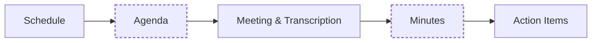

<div align="center">

# Meeting Workflow Engine

**An autonomous, human-in-the-loop system that schedules, prepares, transcribes and tracks meetings end to end.**


[Overview](#-overview) · [Lifecycle](#-lifecycle) · [RBAC](#-access-control) · [Design](#-design) · [Stack](#-tech-stack) · [Structure](#-project-structure)

</div>

<br>

## 📅 Overview

Meetings carry a lot of overhead: finding a time, booking a room or a Zoom link, writing an agenda, transcribing the discussion, writing minutes and chasing action items. This project automates that chain with specialized agents at each stage, while keeping a person with the right role in control of every approval.

|  |  |
|---|---|
| **Domains** | Agentic AI, LLM applications, NLP, RAG, access control |
| **LLM** | Google Gemini (`gemini-2.0-flash-lite`) via `google-genai` and LangChain |
| **Speech to text** | faster-whisper, `tiny` model, INT8 on CPU |
| **Tools** | Custom MCP server for Zoom, calendar and room integrations |
| **Memory** | ChromaDB / TF-IDF retrieval over past meeting decisions |
| **Auth** | OAuth2 password flow, JWT bearer tokens, bcrypt hashing, RBAC |
| **Backend** | FastAPI, SQLAlchemy, SQLite |
| **Frontend** | React 18, TypeScript, Vite |

<br>

## 🔁 Lifecycle



Dashed nodes are approval gates, where the workflow waits for a human with the right role.

| Stage | What happens |
|---|---|
| **1. Schedule** | The organizer enters a title, purpose, date range, duration, equipment needs and attendees. The scheduling agent checks calendars and returns the top 3 ranked time slots with reasoning. The room agent checks capacity and equipment and books a room. A Zoom MCP tool creates a live meeting with a `join_url` through Zoom's Server-to-Server OAuth. |
| **2. Agenda** | The agenda agent retrieves past unfinished items from the vector store and drafts structured topics, durations and discussion leads with Gemini. Organizers and managers edit the draft in the Agenda Editor. An HOD, Principal or Chairman approves it. |
| **3. Meeting & transcription** | Recorded audio (wav, mp3, m4a, ogg, flac, webm) or a pasted transcript is sent to the faster-whisper service, which segments speech with timestamps. Emails, phone numbers and other identifiers are flagged and redacted before storage. Raw and redacted transcripts are saved with a content hash. |
| **4. Minutes** | The minutes agent synthesizes the transcript against the approved agenda into an executive summary, key discussion points, recorded decisions and action items with owners. Once approved, the document is sealed with a SHA-256 content hash. |
| **5. Action items** | Each item is parsed into owner, description, due date and confidence. The Action Tracker shows a Kanban view across Pending, In Progress, Completed and Blocked. A reminder service checks upcoming and overdue items, using idempotency keys to avoid duplicate notifications. |

<br>

## 🔐 Access control

| Role | Can do |
|---|---|
| **Chairman** | Approve any agenda, minutes or room allocation. View evaluations and audit trails. |
| **Principal** | Manage meetings and approve agendas and minutes across departments. |
| **HOD** | Schedule department meetings and approve their agendas and minutes. |
| **Teacher / Staff** | Request meetings, propose agendas and respond to RSVPs. |
| **Student / Guest** | View agendas and distributed minutes. |

<br>

## 🧩 Design

**Human-in-the-loop by design.** Agents draft and recommend. Agenda and minutes approval are held for a role with the authority to grant them.

**One capability boundary.** Zoom, calendar and room access go through a single MCP server (`zoom_tools.py`, `calendar_tools.py`, `room_tools.py`). Agents never call these services directly.

**Memory.** The vector store indexes past meeting decisions and approved minutes, so a query like "what did we decide about the AI lab budget last month" can be answered through `memory_chat.py`.

**Observability.** Every agent invocation, including prompts, tool calls, token usage, latency and output, is logged to an `agent_runs` table and surfaced in the Evaluations dashboard for tracking hallucination rate, tool errors and model performance.

**Audit integrity.** Approved minutes are sealed with a `content_hash`, so a later edit is detectable.

<br>

## 🧰 Tech stack

| Layer | Tools |
|---|---|
| LLM and agents | Google Gemini, `google-genai`, LangChain Google GenAI |
| Speech | faster-whisper |
| Tools and integrations | Custom MCP server, Zoom Server-to-Server OAuth, calendar tools |
| Memory | ChromaDB, TF-IDF retriever |
| Auth | `python-jose` (JWT), `passlib` (bcrypt), OAuth2 password flow |
| Backend | FastAPI, SQLAlchemy, SQLite |
| Frontend | React 18, TypeScript, Vite, `react-router-dom`, `lucide-react` |

<br>

## 🚀 Getting started

**Backend**

```bash
cd backend
uvicorn app.main:app --reload
```

Runs at `http://localhost:8000`.

**Frontend**

```bash
cd frontend
npm install
npm run dev
```

Runs at `http://localhost:5173`.

<br>

## 📁 Project structure

```
.
├── backend/
│   ├── app/
│   │   ├── agents/
│   │   │   ├── scheduling.py        run_scheduling_agent, run_room_booking_agent
│   │   │   ├── agenda.py            run_agenda_agent
│   │   │   └── minutes.py           run_minutes_agent
│   │   ├── services/
│   │   │   └── stt.py               faster-whisper transcription
│   │   ├── memory/
│   │   │   ├── vector_store.py
│   │   │   └── memory_chat.py
│   │   └── sql_app.db
│   └── mcp_server/
│       └── tools/
│           ├── zoom_tools.py
│           ├── calendar_tools.py
│           └── room_tools.py
├── frontend/
│   └── src/
│       ├── pages/
│       │   ├── AgendaEditor.tsx
│       │   └── MinutesReview.tsx
│       └── components/
│           └── ActionTracker.tsx
└── README.md
```
