<div align="center">

# Meeting Organizer Agent

**Multi-agent system that schedules meetings, books Zoom and rooms, drafts agendas and turns transcripts into approved minutes. Built with Gemini, LangGraph and MCP.**


[Overview](#-overview) · [Architecture](#-architecture) · [Access control](#-access-control) · [Evaluation](#-evaluation) · [Stack](#-tech-stack) · [Structure](#-project-structure)

</div>

<br>

## 📅 Overview

Meetings carry a lot of overhead: finding a time, booking a room or a Zoom link, writing an agenda, transcribing the discussion, writing minutes and chasing action items. This project automates that chain with a 9-node LangGraph workflow, while keeping a person with the right role in control of every approval.

|  |  |
|---|---|
| **Domains** | Agentic AI, LLM applications, NLP, RAG, access control |
| **Orchestration** | LangGraph `StateGraph`, 9 nodes, 2 human approval gates |
| **LLM** | Google Gemini (`gemini-3.1-flash-lite`) |
| **Speech to text** | faster-whisper, `tiny` model, INT8 on CPU |
| **Tools** | Custom MCP server for Zoom, calendar and room integrations |
| **Memory** | Custom BM25 retrieval over past meeting minutes |
| **Auth** | OAuth2 password flow, JWT bearer tokens, bcrypt hashing, RBAC |
| **Backend** | FastAPI, SQLAlchemy, SQLite / PostgreSQL |
| **Frontend** | React 18, Vite 5, TypeScript, Tailwind CSS |

<br>

## 🔁 Architecture

```mermaid
flowchart LR
    A[Scheduling Agent] --> B[Room Agent]
    B --> C[Agenda Agent]
    C --> G1{{Agenda approval}}
    G1 --> D[Minutes Agent]
    D --> G2{{Minutes approval}}
    G2 --> E[Action Tracker Agent]
    E --> F[Distribution Agent]
    F --> R[Reminder Agent]

    G1:::gate
    G2:::gate
    classDef gate stroke-width:2px,stroke-dasharray: 4 3
```



| Agent | Role |
|---|---|
| **Scheduling** | Checks attendee calendars and ranks candidate time slots. |
| **Room** | Books a room or a Zoom link through the MCP tool server, rejecting double bookings. |
| **Agenda** | Drafts topics from past meeting context retrieved by BM25, using Gemini. |
| **Minutes** | A dual-pass pipeline that extracts a summary, decisions and action items, grounded in the transcript. |
| **Action Tracker** | Tracks each action item's owner, due date and status on a Kanban board. |
| **Distribution** | Renders minutes to PDF with WeasyPrint and emails them out. |
| **Reminder** | Escalates overdue action items, with idempotency keys to avoid duplicate notifications. |

<br>

## 🔐 Access control

| Role | Can do |
|---|---|
| **Chairman** | Approve any agenda, minutes or room allocation. View evaluations and audit trails. |
| **Principal** | Manage meetings and approve agendas and minutes across departments. |
| **HOD** | Schedule department meetings and approve their agendas and minutes. |
| **Teacher / Staff** | Request meetings, propose agendas and respond to RSVPs. |
| **Student / Guest** | View agendas and distributed minutes. |

<br>

## 📊 Evaluation

A full-stack benchmark suite covers the frontend, API, database, LLM calls, MCP tools, memory retrieval and the workflow end to end. 172 backend unit tests, 9 LangGraph nodes and 4 load profiles were run; the suite and raw results are in `evaluation/`.

| Metric | Baseline | Current |
|---|---|---|
| LLM call availability | 0.0% (60s timeout) | 100.0% (9/9 calls) |
| LLM latency (p50) | 60,000 ms | 1,563 ms |
| HTTP 500 errors | 33.3% of endpoints | 0.0% |
| LangGraph workflow | Failed at distribute | 100.0% end to end |
| Action-item extraction F1 | 0.000 | 1.000 |
| Action-item hallucination rate | — | 0.0% |
| Memory retrieval precision / recall | 1.000 / 0.750 | 1.000 / 1.000 |
| 20-user load, error rate | — | 0.0% over 306 requests |
| Throughput at 20 users | 0.87 req/s (1 user) | 15.64 req/s |

The LLM timeout was a transport bug: the Gemini API key was sent as a header, which hung on some network paths. Routing it as a query parameter fixed every downstream failure, since the failed LLM calls were what caused the HTTP 500s and the broken workflow.

Full detail is in [`evaluation/evaluation_report.md`](evaluation/evaluation_report.md), with test-by-test results in [`evaluation/test_results.md`](evaluation/test_results.md).

<br>

## 🧰 Tech stack

| Layer | Tools |
|---|---|
| Agents and orchestration | LangGraph, Pydantic, Google Gemini |
| Tools and integrations | Custom MCP server, Zoom Server-to-Server OAuth, calendar tools |
| Memory | Custom BM25 retriever over past minutes |
| Auth | `python-jose` (JWT), `passlib` (bcrypt), OAuth2 password flow |
| Backend | FastAPI, SQLAlchemy, SQLite / PostgreSQL |
| Documents and mail | WeasyPrint (PDF), SMTP |
| Frontend | React 18, Vite 5, TypeScript, Tailwind CSS |
| Testing and load | pytest, Locust |

<br>

## 🚀 Getting started

**Backend**

```bash
cd backend
alembic -c ../alembic.ini upgrade head
uvicorn app.main:app --reload
```

Runs at `http://localhost:8000`.

The backend accepts SQLAlchemy database URLs through `DATABASE_URL`. Direct
local runs default to SQLite. Database schema changes are applied with Alembic
before the application starts.

Docker Compose runs the backend and MCP server against its local PostgreSQL
service. Set a strong URL-safe `POSTGRES_PASSWORD` in the ignored `.env` file
before starting Compose:

```bash
docker compose up --build
```

Compose uses a separate `postgres_migration_data` volume and does not use or
alter the SQLite database files. To run Uvicorn directly on the host against
that same local database, start PostgreSQL with `docker compose up -d postgres`
and set `DATABASE_URL` in the ignored `.env` file to
`postgresql+psycopg://postgres:<your-url-safe-password>@localhost:5432/meeting_organizer`.
Inside Compose, the backend uses the `postgres` service hostname instead.

**MCP client (local stdio)**

The project also exposes its tools using the standard MCP stdio transport. From
the project root, configure your MCP client to launch
`.venv\Scripts\python.exe -m mcp_server.stdio_server` with the project root as
its working directory. On macOS/Linux, use `.venv/bin/python` instead. The MCP
client inherits the local environment, including `DATABASE_URL` and any
optional integration settings. Only connect trusted local MCP clients because
the server exposes the registered meeting and room tools to that client.

**Frontend**

```bash
cd frontend
npm install
npm run dev
```

Runs at `http://localhost:5173`.

**Frontend API configuration**

Local Vite development proxies `/api` to `http://127.0.0.1:8000` by default.
Set `VITE_API_URL` to a backend origin (without an `/api/v1` suffix) only when
the frontend and backend are served from different origins; the frontend
appends the API path. `/ready` checks application readiness without querying
the database; `/health` performs a database probe for diagnostics.

**Run the evaluation suite**

```bash
cd evaluation
python bench_api.py
python bench_workflow.py
python bench_llm_quality.py
locust -f locustfile.py --headless -u 20 -r 5 -t 20s
```

<br>

## 📁 Project structure

```
.
├── backend/
│   ├── app/
│   │   ├── agents/
│   │   │   ├── scheduling.py
│   │   │   ├── agenda.py
│   │   │   └── minutes.py
│   │   ├── services/
│   │   │   └── stt.py               faster-whisper transcription
│   │   └── memory/
│   │       └── bm25_store.py
│   └── mcp_server/
│       └── tools/
│           ├── zoom_tools.py
│           ├── calendar_tools.py
│           └── room_tools.py
├── frontend/
│   └── src/
│       ├── pages/
│       │   ├── AgendaEditor.tsx
│       │   └── MinutesReview.tsx
│       └── components/
│           └── ActionTracker.tsx
├── evaluation/
│   ├── evaluation_report.md     full benchmark write-up
│   ├── test_results.md          per-suite pass and fail counts
│   ├── resume_metrics.md
│   └── bench_*.py               individual benchmark scripts
└── README.md
```