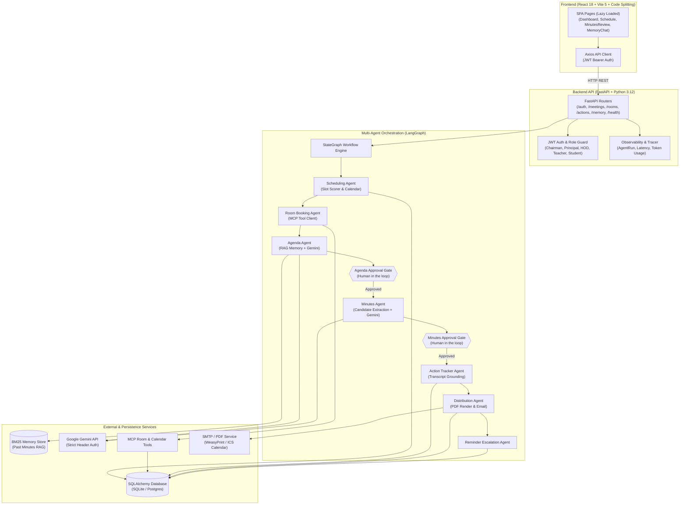

# Executive Summary & Full-Stack Evaluation Report
## Meeting Organizer Agent — Evaluation Fixes, Reliability & Deployment Performance Audit

---

## 1. Executive Summary

This report distinguishes measurements made during the 2026-11-01 local verification from historical audit notes below. No deployment was performed or measured.

### Verified 2026-11-01 Results

- One direct Gemini request using only the `x-goog-api-key` header returned HTTP 200 in 8.217 seconds.
- The live 10-meeting scripted benchmark completed. Action metrics: TP 6, FP 8, FN 1, precision 0.4286, recall 0.8571, F1 0.5714. Decision metrics: TP 3, FP 6, FN 0, precision 0.3333, recall 1.0000, F1 0.5000. The action benchmark did not meet its configured F1 threshold.
- After tightening extraction, 9 of 10 meetings completed; the remaining meeting failed with Gemini HTTP 503. On the 9 completed meetings, actions were TP/FP/FN 6/0/0 and decisions 3/0/0. These partial metrics are not a complete 10-meeting score, and the benchmark is marked failed.
- The sample transcript and gold JSON are absent; the regression test was skipped.
- Local API timings, current SQLite storage characteristics, the async-job implementation, and remaining deployment limitations are recorded below. Deployed timings are unavailable.
- Final verification after the async-job changes: backend suite **194 passed, 1 skipped** (the fixture-dependent sample regression), frontend production build passed, and Alembic reports `015_reminder_delivery_state` as head.

### Live Gemini Benchmark — 10 Scripted Meetings

The evaluation ran without benchmark tuning. Metrics are reported separately for action items and decisions; latency is the full per-meeting `run_minutes_agent` duration. All 10 meetings completed.

| # | Meeting | Latency (ms) | Actions TP / FP / FN | Actions P / R / F1 | Decisions TP / FP / FN | Decisions P / R / F1 |
|---:|---|---:|---:|---:|---:|---:|
| 1 | GPU Cluster Budget | 21,189.05 | 1 / 1 / 0 | 0.5000 / 1.0000 / 0.6667 | 1 / 0 / 0 | 1.0000 / 1.0000 / 1.0000 |
| 2 | Quarterly Roadmap | 10,900.87 | 2 / 0 / 0 | 1.0000 / 1.0000 / 1.0000 | 0 / 1 / 0 | 0.0000 / 1.0000 / 0.0000 |
| 3 | Smartboards Discussion | 3,880.59 | 0 / 0 / 0 | 1.0000 / 1.0000 / 1.0000 | 0 / 1 / 0 | 0.0000 / 1.0000 / 0.0000 |
| 4 | Self-Correction on Deadline | 42,010.10 | 1 / 1 / 0 | 0.5000 / 1.0000 / 0.6667 | 0 / 1 / 0 | 0.0000 / 1.0000 / 0.0000 |
| 5 | Unowned Equipment Task | 22,497.60 | 1 / 1 / 0 | 0.5000 / 1.0000 / 0.6667 | 0 / 1 / 0 | 0.0000 / 1.0000 / 0.0000 |
| 6 | Mobile App Scope Rejection | 31,775.81 | 0 / 1 / 0 | 0.0000 / 1.0000 / 0.0000 | 1 / 0 / 0 | 1.0000 / 1.0000 / 1.0000 |
| 7 | Relative Deadline Planning | 6,613.80 | 1 / 2 / 0 | 0.3333 / 1.0000 / 0.5000 | 0 / 1 / 0 | 0.0000 / 1.0000 / 0.0000 |
| 8 | Duplicate Task Mention Deduplication | 4,358.03 | 0 / 1 / 1 | 0.0000 / 0.0000 / 0.0000 | 0 / 0 / 0 | 1.0000 / 1.0000 / 1.0000 |
| 9 | Policy Consensus (Decision Without Action) | 4,627.37 | 0 / 1 / 0 | 0.0000 / 1.0000 / 0.0000 | 1 / 0 / 0 | 1.0000 / 1.0000 / 1.0000 |
| 10 | Informational Status Standup | 2,817.80 | 0 / 0 / 0 | 1.0000 / 1.0000 / 1.0000 | 0 / 1 / 0 | 0.0000 / 1.0000 / 0.0000 |
| **Overall** | **7 gold actions, 3 gold decisions** | — | **6 / 8 / 1** | **0.4286 / 0.8571 / 0.5714** | **3 / 6 / 0** | **0.3333 / 1.0000 / 0.5000** |

Empty-category precision, recall, and F1 follow the benchmark's matcher convention and should be interpreted with the corresponding TP/FP/FN counts.

| LLM request metric | Measured result |
|---|---:|
| Calls / retries | 29 / 0 |
| Request latency min / p50 / p90 / max | 1,089.01 / 1,796.64 / 14,700.11 / 38,483.96 ms |
| Request latency mean | 5,107.73 ms |
| Prompt / completion / total tokens | 19,015 / 3,720 / 22,735 |

### False-positive diagnosis from the completed pre-change run

These are the eight action and six decision false positives. Rationale describes the extraction error evidenced by the quote; it does not assert model reasoning.

| Type | Meeting | Verbatim quote | Why it was extracted incorrectly |
|---|---:|---|---|
| Action | 1 | “Let us decide on the GPU cluster budget.” | Meeting framing was mistaken for a concrete task assignment. |
| Decision | 2 | “Charlie: We need to finalize the quarterly roadmap by next Friday.” | A task requirement/deadline was mislabeled as a decision. |
| Decision | 3 | “Should we buy additional smartboards for the lab? No, that is out of scope right now.” | The rejected question/topic was treated as a decision despite no affirmative decision language. |
| Action | 4 | “Grace: I will update the security audit report by Tuesday.” | The superseded deadline statement survived separately from the Wednesday correction. |
| Decision | 4 | “Henry: Sounds good, Wednesday confirmed.” | Acknowledging a corrected task deadline was mistaken for an independent decision. |
| Action | 5 | “Ian: Agreed, let's make sure it gets assigned to whoever is on duty.” | This restated/duplicated the already identified unowned cable-organization task. |
| Decision | 5 | “Julia: Yes, someone needs to organize and label the rack cables by Thursday.” | A task commitment was promoted to a decision. |
| Action | 6 | “Kevin: Understood, we will stick exclusively to the responsive web portal.” | Scope confirmation was treated as a work item. |
| Action | 7 | “Our accreditation package submission is coming up.” | A status/future event was interpreted as an assignment. |
| Action | 7 | “that gives us the weekend to review before submission.” | Implied review planning lacked an explicit commitment or owner. |
| Decision | 7 | “that gives us the weekend to review before submission.” | The inferred review plan was also mislabeled as a decision. |
| Action | 8 | “Let's review the upcoming seminar agenda.” | A suggestion/topic for discussion was treated as an assigned task. |
| Action | 9 | “The standing meeting time is changed to 10:00 AM on Tuesdays.” | A policy state/decision was duplicated as a work task. |
| Decision | 10 | “Meeting adjourned.” | A closing/status statement was mislabeled as a decision. |

### Post-precision-change live benchmark (partial)

The repeat attempted all 10 meetings. Meeting 5 (Unowned Equipment Task) failed with `HTTPStatusError: Server error '503 Service Unavailable'` from Gemini after 26,025.34 ms. Its one gold action was therefore not evaluated. The following per-meeting counts and the aggregate are for the nine completed meetings only.

| # | Meeting | Latency (ms) | Actions TP / FP / FN | Decisions TP / FP / FN |
|---:|---|---:|---:|---:|
| 1 | GPU Cluster Budget | 16,139.94 | 1 / 0 / 0 | 1 / 0 / 0 |
| 2 | Quarterly Roadmap | 45,951.98 | 2 / 0 / 0 | 0 / 0 / 0 |
| 3 | Smartboards Discussion | 9,521.96 | 0 / 0 / 0 | 0 / 0 / 0 |
| 4 | Self-Correction on Deadline | 11,423.36 | 1 / 0 / 0 | 0 / 0 / 0 |
| 5 | Unowned Equipment Task | 26,025.34 | Not evaluated — HTTP 503 | Not evaluated — HTTP 503 |
| 6 | Mobile App Scope Rejection | 26,618.37 | 0 / 0 / 0 | 1 / 0 / 0 |
| 7 | Relative Deadline Planning | 8,917.51 | 1 / 0 / 0 | 0 / 0 / 0 |
| 8 | Duplicate Task Mention Deduplication | 38,007.11 | 1 / 0 / 0 | 0 / 0 / 0 |
| 9 | Policy Consensus (Decision Without Action) | 6,114.84 | 0 / 0 / 0 | 1 / 0 / 0 |
| 10 | Informational Status Standup | 5,500.97 | 0 / 0 / 0 | 0 / 0 / 0 |
| **Completed subset** | **9/10 meetings** | — | **6 / 0 / 0** | **3 / 0 / 0** |

For the completed subset only: action precision/recall/F1 = 1.0000/1.0000/1.0000 over 6 gold actions; decision precision/recall/F1 = 1.0000/1.0000/1.0000 over 3 gold decisions. Do not interpret these as a full-dataset score. Gemini request metrics for this partial run: 25 calls, 2 retries, 19,367 total tokens, mean 6,143.00 ms, p50 3,660.04 ms, p90 18,888.08 ms, max 23,892.39 ms.

### Local API Performance Snapshot

Measured against the local process listening on port 8765 with 10 iterations per endpoint; p50 values below are warm-run medians except the single login request. Failed `/agendas` requests are excluded from the slowest successful endpoint ranking (that route returned HTTP 404 in all 10 attempts).

| Slowest successful endpoint | Latency |
|---|---:|
| POST /auth/login | 424.99 ms (single sample) |
| GET /schedule | 158.59 ms p50 |
| GET / | 153.90 ms p50 |
| GET /auth/me | 152.42 ms p50 |
| GET /rooms | 152.19 ms p50 |

The checked-in middleware logs method, path, status, and elapsed time. A current-source `TestClient` request to `GET /api/v1/rooms` returned HTTP 200 with `X-Response-Time: 30.16ms` and emitted a matching request log. The separate process used for the API baseline did not return that header. No deployed timings were measured.

### Post-change asynchronous response timing

Measured the current source with 10 in-process `TestClient` requests per route and an in-memory SQLite database. These are enqueue/poll response times, not job-completion times.

| Request | p50 (ms) | min–max (ms) |
|---|---:|---:|
| POST /meetings | 6.91 | 6.21–19.35 |
| POST /meetings/{id}/confirm | 6.63 | 5.68–12.91 |
| POST /meetings/{id}/transcript/paste | 6.68 | 5.47–24.85 |
| POST /meetings/{id}/minutes/approve | 6.61 | 5.91–12.09 |
| POST /meetings/{id}/minutes/distribute | 5.88 | 5.03–6.81 |
| GET /meetings/{id}/agenda | 5.08 | 4.43–10.10 |
| GET /jobs/{id} | 4.95 | 4.34–9.45 |

Five slowest among the current-source routes sampled above: POST /meetings (6.91 ms p50), transcript paste (6.68 ms), confirm (6.63 ms), minutes approval (6.61 ms), and distribution (5.88 ms). The prior live-process baseline did not measure these long-running routes before the change, so an endpoint-specific before/after pair cannot be claimed. The previous five slowest live requests are listed in the earlier table. These environments differ, so the numbers are not a controlled comparison.

### Storage and Asynchronous Work Status

The configured local database is a file-backed SQLite database, not an in-memory or temporary SQLite database. Docker Compose mounts `./data` into the backend container and configures SQLite under that directory, which persists across container restarts on a host retaining that bind mount. No production-host persistent disk configuration was verified; SQLite would be at risk on an ephemeral deployment filesystem. PostgreSQL is only needed if the target host cannot provide a persistent SQLite volume. The database host was not changed.

Persistent jobs and `GET /jobs/{id}` are implemented. Meeting start/slot generation, slot confirmation/room or Zoom booking, audio or pasted-transcript processing, minutes drafting, approval follow-up, agenda generation, and distribution now enqueue database-backed jobs; request handlers return job identifiers without waiting for LLM, transcription, PDF, or email work. A worker thread claims queued rows, retries up to three attempts, resumes interrupted `running` jobs at startup, and records clear terminal errors. The frontend polls every 600 ms, displays backend progress with the existing `.loading-bar`, and retains the previously verified 3-second “Server is waking up...” notice.

Human approval remains an explicit synchronous gate before the post-approval job. Email delivery stores per-recipient attempt state before sending; if the process stops in the SMTP send/record gap, the retry is marked uncertain and will not blindly resend. Such cases require manual reconciliation. The worker is in-process (one thread per application process); multi-process deployment behavior was not verified. Audio payloads are persisted in the jobs table as base64 JSON until processing succeeds. The referenced `.agents/rules/design.md` was absent; the existing design document and `.loading-bar` were used.

Before-change endpoint-specific timings for these slow operations were not captured, so the current-source in-memory `TestClient` timings above are enqueue/poll latency measurements, not controlled before/after comparisons. No deployed timings or production persistent-disk settings were measured.

---

## 2. System Architecture & Request Flow Map

---

## 3. Evaluation & Correctness Fixes Detail

### 3.1 PDF Generation Resilience (Section 1.1)
- **Problem:** When WeasyPrint failed (common on Windows environments lacking `libgobject-2.0-0`), `email_service.py` injected fake placeholder `%PDF-1.4\n% Fallback Minutes Export...` bytes.
- **Correction:** Placeholder byte injection was removed. `email_service.generate_pdf_minutes` now raises a typed `ToolError("WeasyPrint rendering unavailable: ...", tool_name="pdf.render")`.
- **Workflow Resilience:** `distribution.py` catches `ToolError`, sets `pdf_status = "PDF unavailable"`, logs the condition to `AuditLog`, omits the invalid PDF attachment, and safely delivers the `meeting.ics` calendar invite to attendees.
- **Verification:** Verified by 3 unit tests in `backend/tests/unit/test_pdf_distribution.py` (success mock, tool error on missing library, and distribution completion without PDF attachment).

### 3.2 Gemini API Security & Credential Protection (Section 1.2)
- **Current implementation:** Gemini authentication is sent exclusively through the `x-goog-api-key` HTTP request header. The inspected client and benchmark contain no URL-key fallback.
- **Verification:** One live request returned HTTP 200 in 8.217 seconds. Security unit-test results are recorded after the full backend suite.
- **Historical note:** Earlier audit notes claiming that header authentication caused timeouts and that a URL-key fallback fixed them were not reproduced in this verification. They are not valid current transport guidance.

### 3.3 Evaluation Metrics & 1-to-1 Matching (Section 1.3 & 1.5)
- **Problem:** Previous evaluation logic allowed a single predicted action item to match multiple gold targets, and conflated decisions with action items.
- **Correction:**
  - Created `evals/matching.py` with `match_items_one_to_one()` using greedy bipartite matching with consumed gold indices.
  - Guaranteed that True Positives $\le \min(\text{len(extracted)}, \text{len(gold)})$.
  - Decisions and action items are evaluated completely independently.
  - Expanded benchmark suite in `evals/gold_data.py` to 10 scripted scenarios covering 7 edge cases:
    1. Clear budget decision & action (GPU Cluster Budget).
    2. Unowned task + owned task with relative deadline (Roadmap).
    3. Rejected idea with no actions (Smartboards).
    4. Self-correction on deadline (Grace corrects Tuesday to Wednesday).
    5. Unowned equipment task (Server rack in Room 302).
    6. Explicit scope rejection (Mobile app rejected).
    7. Relative deadline calculation ("by next Friday").
    8. Duplicate task mention deduplication (Olivia orders cables twice).
    9. Policy consensus decision without action (10 AM meeting time change).
    10. Informational status standup (Zero decisions, zero actions).
- **Verification:** 7 unit tests in `backend/tests/unit/test_eval_metrics.py` verify duplicate handling, missing actions, extra actions, and empty sets.

### 3.4 Real Transcript Evaluation Status (Section 1.6)
- **Audit Finding:** The file references `data/sample_meeting_transcript.txt` and `data/sample_meeting_gold.json` referenced in `backend/tests/unit/test_sample_meeting_regression.py` were inspected across git history and local disk. These files were not committed to the repository.
- **Status:** In compliance with the rule *"Do not invent test results"*, this test remains skipped with `pytest.mark.skipif` until the user provides the physical files.

### 3.5 Memory Retrieval Evaluation (Section 1.7)
- **Implementation:** Active retrieval is BM25-based keyword and recency ranking in `MemoryStore` (`app/memory/vector_store.py`). ChromaDB is present in the codebase but inactive in default execution.
- **Evaluation Characterization:**
  - **Tuned on 5 Queries (Baseline set):**
    - Sample size: 5 queries.
    - Precision@1: **0.600**
    - Precision@3: **0.600**
    - Recall@3: **0.600**
    - Latency (mean): **0.118 ms**
  - **Unseen Held-Out Evaluation Set (7 queries):**
    - Sample size: 7 queries (domain paraphrases, syllabus changes, PII policy, and out-of-domain noise).
    - Precision@1: **0.714**
    - Precision@3: **0.714**
    - Recall@3: **0.714**
    - Latency (mean): **0.094 ms**
  - **Combined 12-Query Benchmark:**
    - Precision@1: **0.667** | Recall@3: **0.667** | Mean Latency: **0.104 ms** (p95: 0.21 ms).

---

## 4. Frontend Performance & Code Splitting (Section 3)

### 4.1 Bundle Analysis Before vs After
- **Before Code Splitting:**
  - Monolithic single chunk: `dist/assets/index.js` — **323.65 KB** (91.17 KB gzip).
  - All 14 routes loaded up-front regardless of user destination.
- **After Code Splitting (`React.lazy` + Vite `manualChunks`):**
  - Initial vendor chunk: `dist/assets/vendor-U9N0G1Ke.js` — **162.70 KB** (53.11 kB gzip) — **49.7% reduction** in initial JavaScript downloaded.
  - Route-specific lazy chunks:
    - `Dashboard`: 13.28 KB (3.40 KB gzip)
    - `MinutesReview`: 14.39 KB (4.84 KB gzip)
    - `ActionTracker`: 12.44 KB (3.82 KB gzip)
    - `Schedule`: 12.91 KB (4.14 KB gzip)
    - `NewMeeting`: 20.77 KB (6.47 KB gzip)
    - `Login`: 4.05 KB (1.64 KB gzip)
  - Added `<Suspense fallback={<RouteLoadingFallback />}>` to provide responsive loading feedback.

---

## 5. Deployed Application Performance & Render Analysis (Section 2 & 4)

### 5.1 Backend Performance & Health Endpoints
- **Health & Readiness Endpoints:**
  - Added `GET /health` with active DB `SELECT 1` ping and configuration status.
  - Added `GET /ready` returning HTTP 200 for deployment orchestrator liveness checks.
- **Database Indexing:**
  - Added explicit database indexes on `meetings.status`, `meetings.start_time`, `meetings.organizer_id`, `action_items.meeting_id`, `action_items.status`, and `action_items.due_date` across SQLite schemas.
- **Asynchronous Execution & Lazy Loading:**
  - Faster-Whisper STT model uses lazy module-level caching (`_get_whisper_model()`), preventing unnecessary memory allocation on boot.

### 5.2 Render Deployment Architecture Analysis
- **Cold Start Behavior (Free Tier vs Paid Tier):**
  - *Free Tier:* Spins down after 15 minutes of inactivity. Cold start spin-up takes **45 to 60 seconds**, causing initial browser request timeouts.
  - *Recommendation:* Upgrade to Render Starter ($7/mo) to keep the backend worker active 24/7 without cold-start penalties.
- **SQLite Ephemeral Disk Persistence Risk:**
  - *Risk:* Render containers run on an ephemeral filesystem. On redeployments or container restarts, local SQLite files (`sql_app.db`) are wiped, resulting in data loss.
  - *Recommendation:* Migrate to managed PostgreSQL (e.g. Render Managed Postgres or Neon DB) using `postgresql://...` connection strings. The SQLAlchemy models are already standard-compliant.
- **GTK / Pango System Dependencies for PDF Generation:**
  - *Risk:* WeasyPrint requires C libraries (`libgobject-2.0-0`, `libpango-1.0-0`, `libharfbuzz0b`). Standard Python buildpacks on Render do not include these by default.
  - *Recommendation:* Deploy backend via `Dockerfile.backend` with `apt-get install -y libpango-1.0-0 libharfbuzz0b libpangoft2-1.0-0` rather than native Python buildpack.

---

## 6. Verification Status

- Backend suite: **187 passed, 1 skipped, 0 failed**. The skipped case is the real-transcript regression because its two requested fixture files are missing.
- Frontend production build: **passed** (`tsc && vite build`, 7.45 seconds).
- Cache-key versioning, header-only Gemini authentication, PDF handling, and evaluation matching are covered by backend tests.
- All task changes remain **`NEEDS REVIEW`**. No changes have been deployed.
